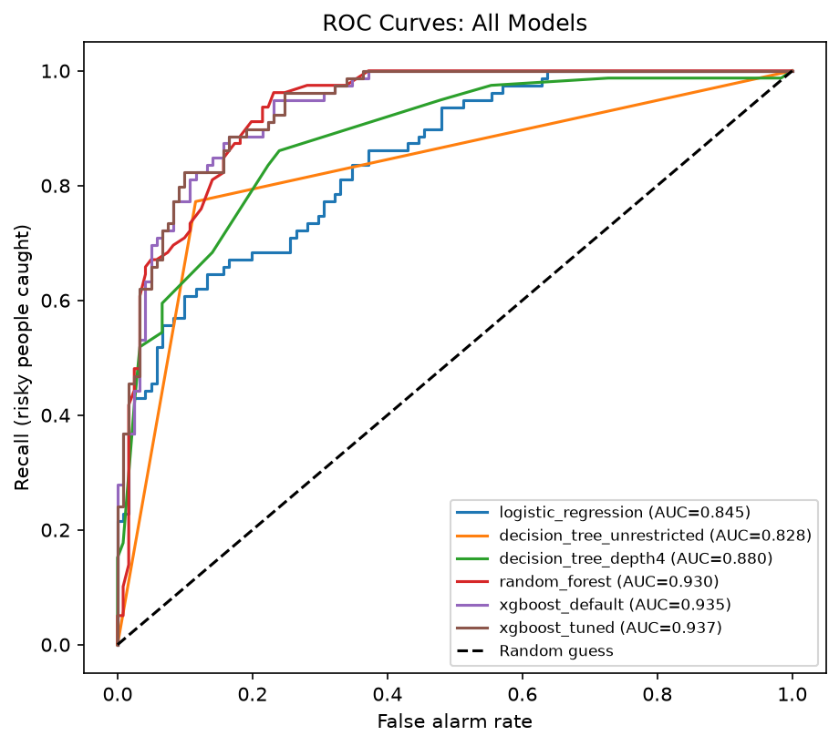

# Credit Risk Classification

Predicting which loan applicants are likely to default, using the German Credit dataset. The project covers exploratory analysis, preprocessing, four models, hyperparameter tuning and experiment tracking with MLflow.

## Results (200 unseen test applicants)

| Model | Accuracy | Recall (bad) | Missed risky | False alarms |
|---|---|---|---|---|
| Logistic regression | 76.5% | 65.8% | 27 | 20 |
| Decision tree (no limit) | 84.0% | 77.2% | 18 | 14 |
| Decision tree (depth 4) | 80.0% | 59.5% | 32 | 8 |
| Random forest | 83.0% | 73.4% | 21 | 13 |
| **XGBoost (default)** | **86.0%** | **82.3%** | **14** | 14 |
| XGBoost (tuned) | 85.5% | 77.2% | 18 | 11 |

"Recall (bad)" is the share of truly risky applicants the model caught. It is the priority metric because approving someone who defaults costs far more than turning away a good customer (the course brief assumes roughly 5 to 1).



## Highlights

- **Tested an idea before acting on it.** Applicants with a blank savings account had a 58.8% bad-credit rate, against 37.8% for everyone else. So blanks were filled with an explicit "none" category instead of the most common value, which would have erased that signal.
- **Showed overfitting with numbers.** An unrestricted decision tree scored 100% on training data and 84% on unseen data. Limiting its depth closed the gap but made it much worse at catching risky applicants.
- **Reported a negative result.** Hyperparameter tuning looked better in cross-validation but did not beat the default XGBoost on the test set.
- **Caught and fixed a data leakage mistake.** I originally scaled the numeric features before splitting the data, so test-set information leaked into training. I fixed it by fitting the scaler on the training set only. The full story is in the report.

## Project structure

- `Data/` - German Credit dataset
- `credit_risk_pipeline.ipynb` - full analysis, from EDA to final model
- `Models/` - saved final model (default XGBoost)
- `Visualizations/` - ROC curves, confusion matrix, feature importance
- `Report/` - technical report (PDF) and model comparison table

## How to run

1. Create and activate a virtual environment (Python 3.10 or newer).
2. Install the dependencies:

```
pip install -r requirements.txt
```

3. Open `credit_risk_pipeline.ipynb` in JupyterLab and run the cells from the top.

## Limitations

- Small dataset: 1,000 rows, with only 79 risky applicants in the test set, so small differences between models are within noise.
- The final model was chosen by looking at test-set scores, so the reported numbers are slightly optimistic. A validation set would be the cleaner approach.
- The 5-to-1 cost ratio is an assumption from the course brief, not a real bank's figure.
- `sex` is a feature in the data. In real lending this raises fairness and legal questions that would need a proper review.

## Next steps

Wrap preprocessing and the model in a scikit-learn Pipeline, serve it with FastAPI, containerize it with Docker, and add automated tests with GitHub Actions.

## Data

German Credit dataset, originally from the UCI Machine Learning Repository.

Author: Pranali Rokade | https://www.linkedin.com/in/pranalirokade
